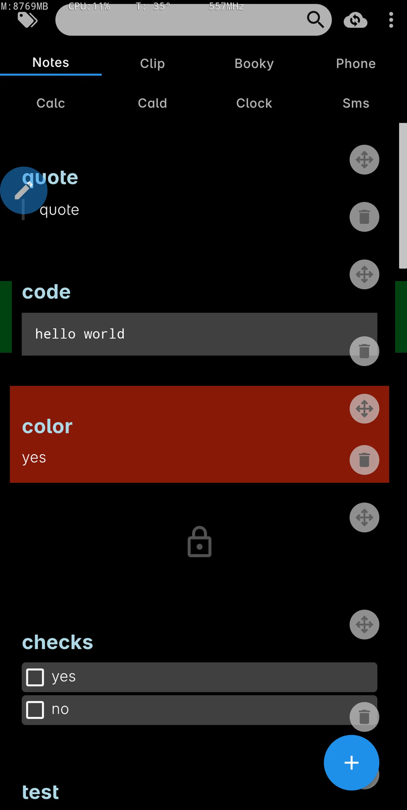
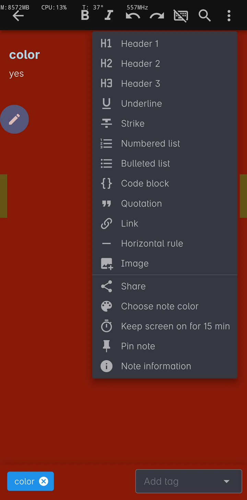
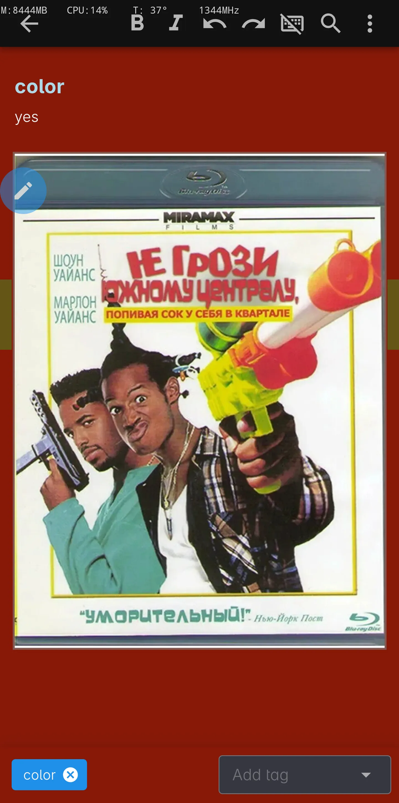
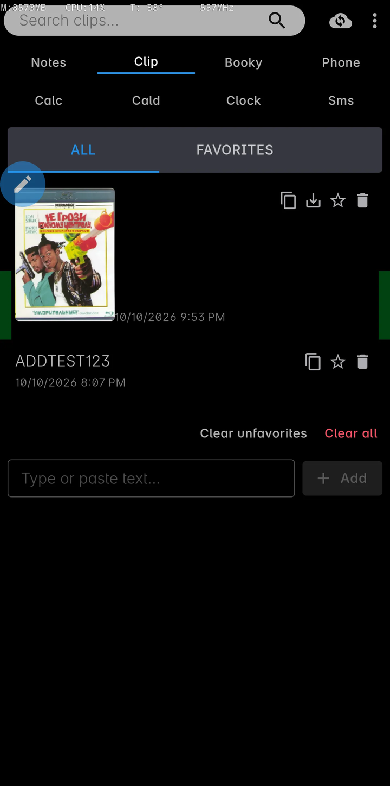
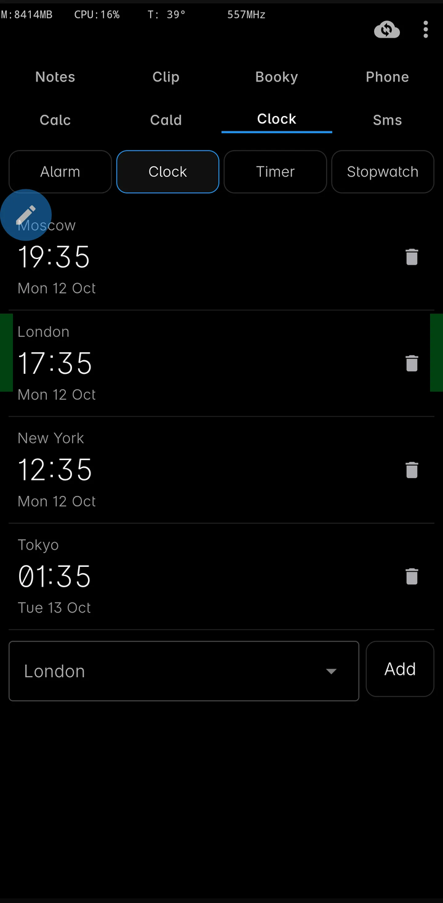
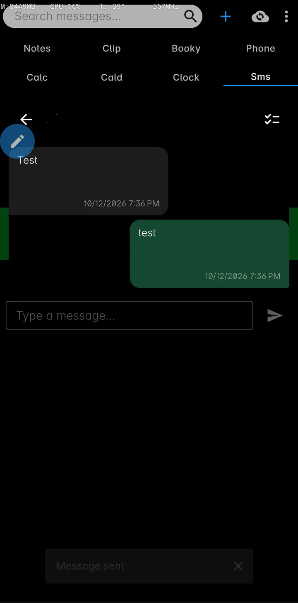
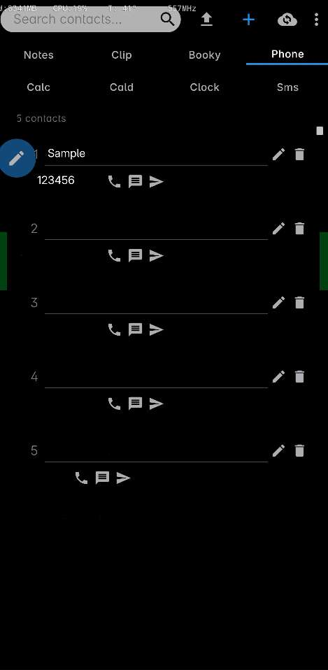
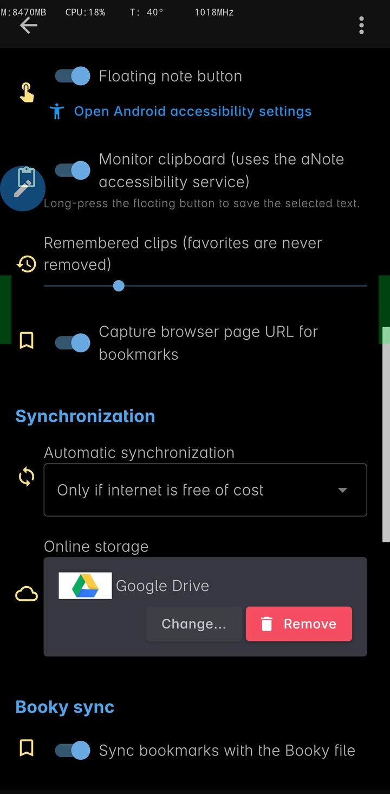

# aNote

aNote is a private note taking app for Android (and Windows), based on the open source
[SilentNotes](https://www.martinstoeckli.ch/silentnotes) project. It keeps everything of the
original — the WYSIWYG editor, checklists, safes, full-text search, tags, the encrypted repository
and the synchronization with a self hosted online storage — and adds a clipboard history, bookmarks,
a phone contact list, a calculator, a calendar, a clock and SMS.

The notes never leave the device unencrypted, they are end-to-end encrypted and can only be read on
your devices.

If you want to help, please read the [contribution guidelines](CONTRIBUTING.md).

## Features

* ✔ Take your notes wherever you are on your Android and Windows devices.
* ✔ Write the notes in an easily operated WYSIWYG editor.
* ✔ Create To-Do lists to keep an overview of your pending tasks.
* ✔ Add pictures to your notes, they are downscaled and embedded into the note.
* ✔ Protect your notes with a user defined password.
* ✔ Quickly find the right note with the full-text search, just by typing a few letters.
* ✔ Organize and filter the notes with a tagging system.
* ✔ Store the notes to an online-storage of your choice (self hosting), this allows to synchronize them between devices and offers an easy backup.
* ✔ Currently supported are the `FTP` protocol, the `WebDav` protocol, `Dropbox`, `Google-Drive` and `One-Drive`.
* ✔ The notes never leave the device unencrypted, they are end-to-end encrypted and can only be read on your devices.
* ✔ Use basic formatting to structure your notes and make them more readable.
* ✔ Get a note back from the recycle-bin if it was deleted by accident.
* ✔ Keep a history of copied texts and pictures in the clipboard tab.
* ✔ Collect bookmarks, synchronized with the Booky browser extension.
* ✔ Keep a small phone book inside the encrypted repository.
* ✔ A calculator with a scientific mode.
* ✔ Show the calendars of the device with their events and reminders.
* ✔ Alarms, a world clock, a timer and a stopwatch.
* ✔ Read and write SMS, and act as the default SMS app.
* ✔ Scan and create QR codes.
* ✔ Record sound, play it back and save recordings to the device.
* ✔ Exchange files with a WebDAV server.
* ✔ Place calls and optionally act as the default Phone app.
* ✔ Take photos in JPG, PNG or WEBP format with a configurable quality percentage (1–100%).
* ✔ Read, search and send emails across multiple IMAP/SMTP accounts in the Mail tab.
* ✔ Act as the default system browser (URLCheck mode) to inspect, clean and route links to any installed browser.
* ✔ Floating button quick menu (draggable & resizable floating window) for all tabs, system keyboard switching, and customizable directional swipe / long-press / double-click app launcher gestures.
* ✔ A plain black theme, which is friendly to AMOLED displays.
* ✔ aNote does not collect user information and requires no unnecessary privileges.

## Screenshots

| | | |
| --- | --- | --- |
|  |  |  |
| Notes | Note editor | Picture in a note |
|  |  |  |
| Clipboard history | Clock | Messages |
|  |  | |
| Phone contacts | Settings | |

## The tabs

The app is organized in fourteen tabs across three rows:
**Notes · Clip · Booky · Phone**, **Calc · Cald · Clock · Sms · QR**, and **Rec · File · Dialer · Camera · Mail**.

### Notes

Take notes and checklists in an easily operated WYSIWYG editor, protect them with a user defined
password, organize them with tags and find them again with the full-text search. Notes can contain
pictures, which are downscaled and embedded into the note. The notes are synchronized with the
online storage of your choice.

### Clip — clipboard history

The **Clip** tab keeps a history of copied texts and pictures, so something you copied earlier can be
pasted again later. Favorites are never removed automatically, everything else is limited by the
"Remembered clips" setting.

How the clipboard is monitored:

* The history is collected by aNote's **accessibility service**. It runs in the background and
  watches the system clipboard for changes.
* Android hides the clipboard from apps which are not in the foreground (since Android 10 only the
  focused app is allowed to read it). So that aNote can still read the clipboard in the background,
  the app has to be **whitelisted for clipboard access**. On a rooted device this can be done with an
  Xposed/LSPosed module, for example
  [entr0pia/xposed-clipboard-whitelist](https://github.com/entr0pia/xposed-clipboard-whitelist)
  (there are alternative modules with the same purpose). Add aNote to the module's whitelist and
  reboot.
* Without such a whitelist, the clipboard is still captured when aNote comes to the foreground, and
  text can be saved on purpose:
  * **Long-press the floating button** to save the text which is currently selected in any app
    (also works in web pages).
  * **Share or select text with aNote** (the "aNote" entry in the Android text selection menu)
    to store it in the clipboard history.
* Copied pictures are shown as a thumbnail. Tapping the picture opens it in a viewer app, and the
  download button saves it as a JPEG into `Pictures/clips` of your phone.

### Booky — bookmarks

The **Booky** tab collects bookmarks, optionally together with the text you selected on the page.

The bookmark list is synchronized through a single plain JSON file (`bookmarks.json`) on a WebDAV
server, so the same bookmarks are available everywhere:

* on the phone in the Booky tab of aNote,
* in the desktop browser through the **Booky browser extension** (Manifest V3, works in Chromium
  browsers and Firefox) — the extension is what lets you bookmark a selected text from the browser,
* and in the separate Booky Android app.

The browser extension is needed to capture bookmarks while browsing; aNote and the extension keep the
file in sync, so a bookmark added in the browser appears on the phone and vice versa. Configure the
WebDAV base URL, the remote file path and the credentials in *Settings → Booky sync*; the password is
stored encrypted on the device only.

### Phone — contact list

A deliberately simple contact list: a name and one or more phone numbers. It is stored inside the
note repository, therefore it is encrypted and synchronized together with your notes, and it does
not read the system contacts (no contacts permission is required). Numbers can be imported from an
exported contacts file (`html`, `json` or `txt`, e.g. a Google contacts export). For every number you
can copy it, start a call, write an SMS or open Telegram.

### Calc

A calculator with the usual arithmetic, a percent key and a history of the last results. A scientific
mode adds trigonometry (also inverse and cotangent), logarithms, powers and roots, factorials,
`exp`, `π` and `e`, and a switch between degrees and radians.

### Cald — calendar

The **Cald** tab shows the calendars of the device, including the ones which are synchronized by a
Google account. It offers a month grid with a day indicator, the event list of a day (single tap
selects a day, a double tap opens its list) and an editor for new or existing events with title,
location, notes, color and **several reminders** per event. aNote also appears in the calendar
choosers of other apps, so an event can be opened or created directly from aNote.

### Clock

The clock offers the four standard sections:

* **Alarm** — real system alarms, scheduled with the Android alarm manager. They ring with sound and a
  full-screen notification even when aNote is closed, and they are rescheduled after a reboot.
* **Clock** — a world clock with several cities, more can be added from a catalog of cities.
* **Timer** — a countdown which alerts you when aNote is in the background.
* **Stopwatch** — with laps.

### Sms — messages

Read your conversations and messages, send text messages, delete a whole conversation or single
selected messages, and mark a conversation — or all of them at once — as read.

To **receive** incoming messages (and to be able to store or delete messages) aNote has to be the
**default SMS app**. The button "Set as default SMS app" in the Sms tab opens the system dialog for
that. MMS are not supported.

### QR

Scan QR codes with the camera, decode them from an image file, keep a history of scans, and generate
your own QR codes from text or a link.

### Rec — sound recordings

Record audio with pause and resume, play recordings back, rename them, share them, or save a copy
to `Music/Recordings` on the device. Microphone permission is requested when you start recording.

### File — WebDAV exchange

Browse, upload, download, create folders and delete files on a WebDAV server. Credentials can be set
in the tab itself, or you can reuse the Booky sync WebDAV settings.

### Dialer — phone app

A numpad and call history to place calls. Optionally set aNote as the default Phone app so it can
handle incoming and outgoing calls via Android's dialer role.

## Permissions and accessibility

aNote asks for as little as possible, and most permissions are only requested when you actually use
the corresponding tab:

* **Internet / network state** — only for the synchronization with your online storage.
* **Notifications** (Android 13+) — for ringing alarms, finished timers and received messages.
* **Alarms and reminders** — exact alarms (`SCHEDULE_EXACT_ALARM`, `USE_EXACT_ALARM`) and the
  full-screen intent permission, so an alarm can ring reliably.
* **Calendar** (read/write) — for the Cald tab, requested when you open it.
* **SMS** (read/send/receive) — for the Sms tab. To receive and to delete messages aNote must be set
  as the default SMS app.
* **Camera** — for the QR tab, requested when you scan a code.
* **Microphone** — for the Rec tab, requested when you start a recording.
* **Phone / call log** — for the Dialer tab (place calls, read call history). To handle incoming
  calls aNote can be set as the default Phone app.
* **Display over other apps** — only for the floating button overlay.
* **Vibration / wake lock / boot completed** — to ring, vibrate and to reschedule the alarms after a
  reboot.

**Accessibility service** (optional, you enable it manually in the Android accessibility settings):
aNote's accessibility service provides the **floating button** and the **clipboard monitoring**, and
it can capture the URL of the page currently open in a browser so it can be used as the default
address for a new bookmark. It is only active while the corresponding options are switched on, and it
can be disabled again at any time in the Android settings.

aNote does not need access to your contacts or your location, and it does not collect any user
information.

## Security

Whenever an application promises security and confidentiality, users just have to trust the developer
team. Not only is it challenging to do encryption right, users are more and more accustomed to pay
with their personal data, to benefit from new technologies. We believe that the best way to build
trust is to publish the entire source code, this is why aNote was turned into an open source project.

## Credits

* aNote is based on the open source project [SilentNotes](https://www.martinstoeckli.ch/silentnotes)
  by Martin Stöckli, published under the terms of the Mozilla Public License v. 2.0.
* The [TipTap](https://tiptap.dev)/[ProseMirror](https://prosemirror.net/) editor made it possible to offer WYSIWYG note editing across platforms.
* Cryptograhic tasks are solved with the [Bouncy Castle](https://bouncycastle.org/) crypto API.
* The clean and minimalistic [Flurl](https://flurl.dev/) library helped a lot to keep the HTTP requests readable.
