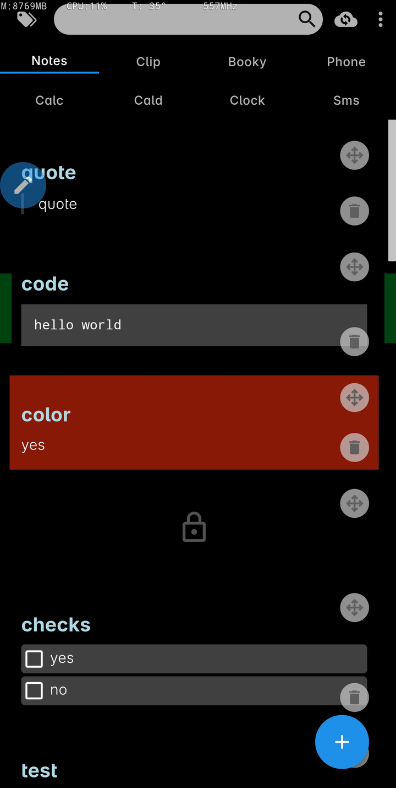
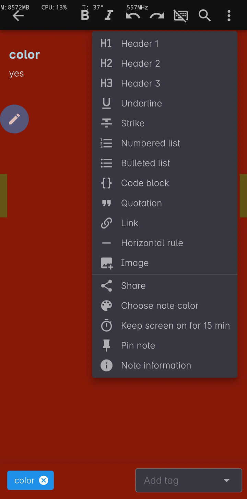
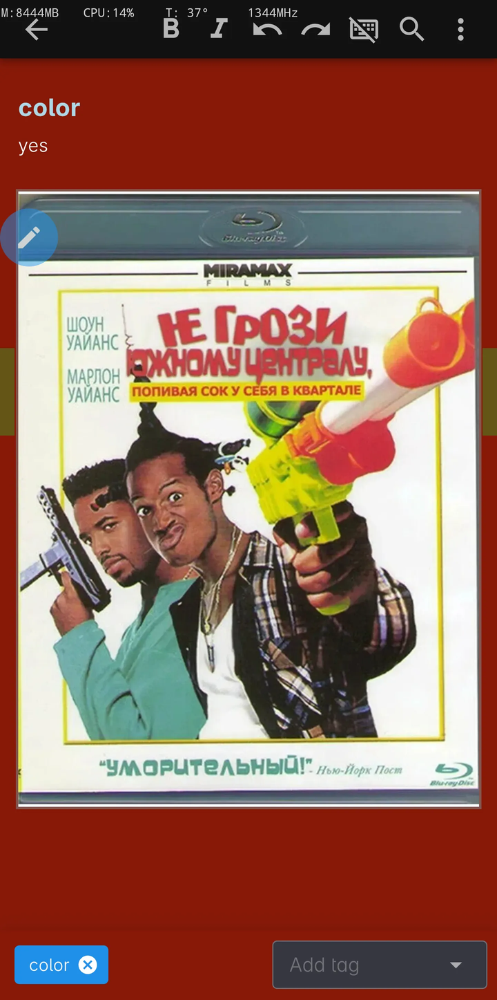
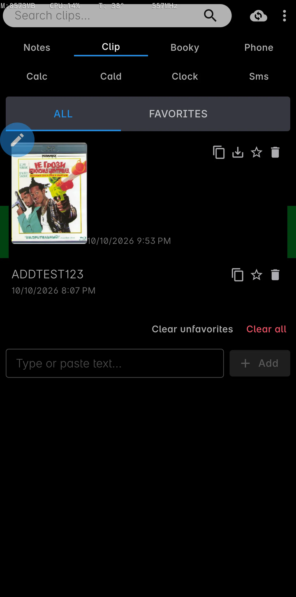
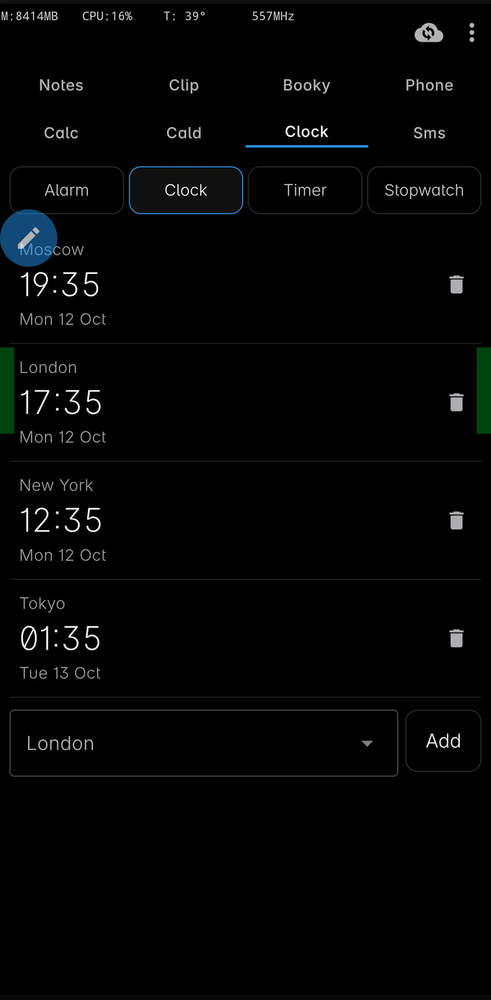
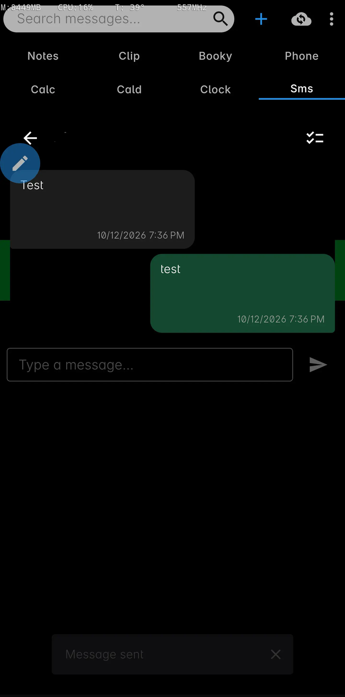
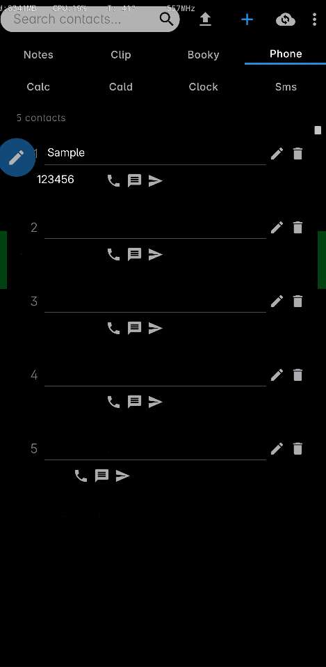
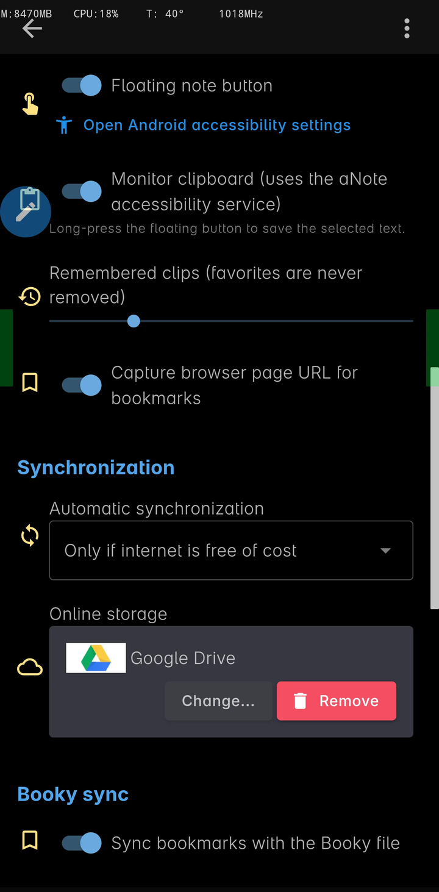

# aNote

aNote is a private note taking app for Android (and Windows), based on the open source
[SilentNotes](https://www.martinstoeckli.ch/silentnotes) project. It keeps everything of the
original — the WYSIWYG editor, checklists, safes, full-text search, tags, the encrypted repository
and the synchronization with a self hosted online storage — and adds twenty-one tabs: a clipboard
history, bookmarks, a contact list, a calculator, a calendar, a clock, SMS, mail, Telegram, an RSS
reader, a password vault, a media player, a document reader, a camera, a recorder, QR codes, a
WebDAV file manager, a dialer, a browser with AI chat and a voice assistant. A separate system page
adds device diagnostics and a log viewer.

The notes never leave the device unencrypted, they are end-to-end encrypted and can only be read on
your devices.

If you want to help, please read the [contribution guidelines](CONTRIBUTING.md).

## Features

* ✔ Take your notes wherever you are on your Android and Windows devices.
* ✔ Write the notes in an easily operated WYSIWYG editor.
* ✔ Format the notes with bold, italic, underline and strike, headers, ordered and unordered lists,
  code blocks, quotations, links, horizontal rules, tables (3×3, with add/delete row and column) and
  line/text colors.
* ✔ Create To-Do lists and checklists to keep an overview of your pending tasks, with reordering,
  sorting, check-all/uncheck-all and a shopping mode.
* ✔ Add pictures to your notes, they are downscaled and embedded into the note.
* ✔ Protect your notes with a user defined password and keep them in safes.
* ✔ Quickly find the right note with the full-text search, just by typing a few letters.
* ✔ Organize and filter the notes with a tagging system, and pin important notes to the top.
* ✔ Get a note back from the recycle-bin if it was deleted by accident.
* ✔ Store the notes to an online-storage of your choice (self hosting), this allows to synchronize them between devices and offers an easy backup.
* ✔ Currently supported are the `FTP` protocol, the `WebDav` protocol, `Dropbox`, `Google-Drive` and `One-Drive`.
* ✔ The notes never leave the device unencrypted, they are end-to-end encrypted and can only be read on your devices.
* ✔ Choose the encryption and key derivation algorithm used for the encrypted repository.
* ✔ Keep a history of copied texts and pictures in the clipboard tab.
* ✔ Collect bookmarks, synchronized with the Booky browser extension.
* ✔ Keep a small phone book inside the encrypted repository.
* ✔ A calculator with a scientific mode.
* ✔ Show the calendars of the device with their events and reminders, plus date tools.
* ✔ Alarms, a world clock, a timer, a stopwatch and a compass.
* ✔ Read and write SMS, and act as the default SMS app.
* ✔ Read, search and send emails across multiple IMAP/SMTP accounts in the Mail tab.
* ✔ Use Telegram from inside aNote, with multiple accounts and an optional MTProto proxy.
* ✔ Follow RSS and Atom feeds, with OPML import/export.
* ✔ Keep logins with usernames, passwords, TOTP codes and URIs in an encrypted password vault, import from Bitwarden and use it as the Android Autofill service.
* ✔ Scan and create QR codes, decode them from image files and keep a scan history.
* ✔ Record sound, record the screen, take screenshots, play recordings back and save them to the device.
* ✔ Take photos in JPG, PNG or WEBP format with a configurable quality percentage (1–100%), and record videos.
* ✔ Exchange files with a WebDAV server, and quickly save files from other tabs to WebDAV.
* ✔ Place calls and optionally act as the default Phone app.
* ✔ Browse local media and documents with the Player and Reader tabs, including PDF, DjVu, Office and ebook files.
* ✔ Play audio and video from a URL, and download media with yt-dlp from YouTube, VK, Vimeo, Reddit and other supported sites.
* ✔ A built-in multi-tab browser (Abro) with ad blocking, saved pages, downloads, PDF export, history, bookmarks and an AI chat.
* ✔ Ask AI about notes, RSS articles and files, using OpenAI-compatible providers.
* ✔ Act as the default system browser (URLCheck mode) to inspect, clean and route links to any installed browser.
* ✔ Act as the default assistant, so the assist gesture can dictate a note and attach a screenshot.
* ✔ Floating button quick menu (draggable & resizable floating window) for all tabs, system keyboard switching, and customizable directional swipe / long-press / double-click app launcher gestures.
* ✔ A system page with battery, hardware, storage, processes, memory, network tools and logcat, plus an in-app log viewer.
* ✔ Reorder the tabs on the main screen.
* ✔ A plain black theme, which is friendly to AMOLED displays.
* ✔ aNote does not collect user information and requires no unnecessary privileges.

## Screenshots

| | | |
| --- | --- | --- |
|  |  |  |
| Notes | Note editor | Picture in a note |
|  |  |  |
| Clipboard history | Clock | Messages |
|  |  | |
| Phone contacts | Settings | |

## The tabs

The app is organized in twenty-one tabs, shown five per row: **Voice · Notes · Clip · Booky · Phone**,
**RSS · Calc · Cald · Clock · Sms**, **QR · Rec · File · Dialer · Camera**, **Mail · Player · Reader ·
Password · TG**, and **Abro**.

The order of the tabs can be changed in *Settings → Main tab order*. Tab shortcuts and gestures keep
their original numbers, and the Voice tab stays pinned first.

### Notes

Take notes and checklists in an easily operated WYSIWYG editor, protect them with a user defined
password, organize them with tags and find them again with the full-text search. Notes can contain
pictures, which are downscaled and embedded into the note, tables, horizontal rules and line/text
colors. Notes can be pinned, shared, exported and imported, and the note information shows its
metadata. The notes are synchronized with the online storage of your choice.

### Clip — clipboard history

The **Clip** tab keeps a history of copied texts and pictures, so something you copied earlier can be
pasted again later. Favorites are never removed automatically, everything else is limited by the
"Remembered clips" setting. Clips can be searched, added manually, copied back to the clipboard and
cleared.

How the clipboard is monitored:

* The history is collected by aNote's **accessibility service**. It runs in the background and
  watches the system clipboard for changes.
* Android hides the clipboard from apps which are not in the foreground (since Android 10 only the
  focused app is allowed to read it). So that aNote can still read the clipboard in the background,
  the app has to be **whitelisted for clipboard access**. On a rooted device this can be done with an
  Xposed/LSPosed module, for example
  [entr0pia/xposed-clipboard-whitelist](https://github.com/entr0pia/xposed-clipboard-whitelist)
  (there are alternative modules with the same purpose). Add aNote to the module's whitelist and
  reboot.
* Without such a whitelist, the clipboard is still captured when aNote comes to the foreground, and
  text can be saved on purpose:
  * **Long-press the floating button** to save the text which is currently selected in any app
    (also works in web pages).
  * **Share or select text with aNote** (the "aNote" entry in the Android text selection menu)
    to store it in the clipboard history.
* Copied pictures are shown as a thumbnail. Tapping the picture opens it in a viewer app, and the
  download button saves it as a JPEG into `Pictures/clips` of your phone.
* Optionally the clipboard history can be uploaded to WebDAV as `anote/clipboard_sync.json`, which
  the desktop clipmon tool reads.

### Booky — bookmarks

The **Booky** tab collects bookmarks, optionally together with the text you selected on the page.

The bookmark list is synchronized through a single plain JSON file (`bookmarks.json`) on a WebDAV
server, so the same bookmarks are available everywhere:

* on the phone in the Booky tab of aNote,
* in the desktop browser through the **Booky browser extension** (Manifest V3, works in Chromium
  browsers and Firefox) — the extension is what lets you bookmark a selected text from the browser,
* and in the separate Booky Android app.

The browser extension is needed to capture bookmarks while browsing; aNote and the extension keep the
file in sync, so a bookmark added in the browser appears on the phone and vice versa. Configure the
WebDAV base URL, the remote file path and the credentials in *Settings → Booky sync*; the password is
stored encrypted on the device only. The same WebDAV credentials are reused for the password vault,
the Abro AI store and the clipboard sync file. A manual sync can merge the local and server
bookmarks, or replace the server file with the local ones.

### Phone — contact list

A deliberately simple contact list: a name and one or more phone numbers. It is stored inside the
note repository, therefore it is encrypted and synchronized together with your notes, and it does
not read the system contacts (no contacts permission is required). Numbers can be imported from an
exported contacts file (`html`, `json` or `txt`, e.g. a Google contacts export). For every number you
can copy it, start a call, write an SMS or open Telegram.

### RSS — feeds

Follow RSS and Atom feeds in one list. Feeds can be added, edited and deleted, articles are shown
with their feed, date and summary, and the list can be searched and refreshed. OPML files can be
imported and exported (also to WebDAV), articles can be opened in the browser, saved to WebDAV, and
sent to Ask AI.

### Calc

A calculator with the usual arithmetic, a percent key and a history of the last results. A scientific
mode adds trigonometry (also inverse and cotangent), logarithms, powers and roots, factorials,
`exp`, `π` and `e`, and a switch between degrees and radians.

### Cald — calendar

The **Cald** tab shows the calendars of the device, including the ones which are synchronized by a
Google account. It offers a month grid with a day indicator, the event list of a day (single tap
selects a day, a double tap opens its list) and an editor for new or existing events with title,
location, notes, color and **several reminders** per event. aNote also appears in the calendar
choosers of other apps, so an event can be opened or created directly from aNote. Date tools help
with date differences, second/minute/hour conversions and Unix timestamps.

### Clock

The clock offers the standard sections:

* **Alarm** — real system alarms, scheduled with the Android alarm manager. They ring with sound and a
  full-screen notification even when aNote is closed, and they are rescheduled after a reboot.
* **Clock** — a world clock with several cities, more can be added from a catalog of cities.
* **Timer** — a countdown which alerts you when aNote is in the background.
* **Stopwatch** — with laps.
* **Compass** — uses the device sensors when they are available.

### Sms — messages

Read your conversations and messages, send text messages, delete a whole conversation or single
selected messages, and mark a conversation — or all of them at once — as read.

To **receive** incoming messages (and to be able to store or delete messages) aNote has to be the
**default SMS app**. The button "Set as default SMS app" in the Sms tab opens the system dialog for
that. MMS are not supported.

### QR

Scan QR codes with the camera, decode them from an image file, keep a history of scans, and generate
your own QR codes from text or a link. The result can be copied, shared or opened as a link, and the
generated image can be saved. Settings control vibration, automatic copying and whether the history
is kept.

### Rec — recordings, screen and screenshots

The **Rec** tab has three sections:

* **Audio** — record sound with pause and resume, play recordings back, rename them, share them, or
  save a copy to `Music/Recordings` on the device.
* **Screen** — record the screen via the system screen capture dialog.
* **Shots** — take full or partial screenshots (Android 11 or newer), crop them, and open them in an
  image editor.

Microphone permission is requested when you start recording.

### File — WebDAV exchange

Browse, upload, download, create folders and delete files on a WebDAV server. Credentials can be set
in the tab itself, or you can reuse the Booky sync WebDAV settings. Other tabs (Player, Reader, RSS,
TG) reuse the same credentials for their "Save to WebDAV" buttons.

### Dialer — phone app

A numpad and call history to place calls. Optionally set aNote as the default Phone app so it can
handle incoming and outgoing calls via Android's dialer role.

### Camera

Take photos in JPG, PNG or WEBP format with a configurable quality percentage (1–100%), and record
videos with a configurable bitrate and optional sound. The tab offers back/front lens switching,
flash and torch, an overview of the photos and videos, renaming, deleting, re-encoding images with
the selected format and quality, auto-saving captures to the gallery, and saving copies to
`/sdcard/anote/pic`. The system camera can be used as an alternative.

### Mail

Read, search and send emails across one or more IMAP/SMTP accounts (Gmail, Outlook, Mail.ru, Yandex,
Yahoo, iCloud or a custom server). The tab offers inbox, starred, sent, drafts, trash and "all mail"
folders, search across all accounts, composing, replying, replying to all, forwarding, attachments,
drafts, marking messages read/unread and emptying the trash. Accounts can be added with provider
presets or with Google sign-in, tested and imported/exported.

### Player

Browse audio, video and image files in any folder with multiple path tabs and filters. Audio files
can be played directly with play/pause, stop, seek and progress, and videos and images open in a
viewer. Files can be shared, deleted (also in multi-selection) or saved to WebDAV. A URL can be
played directly, and media URLs can be downloaded with **yt-dlp** (YouTube, VK, Vimeo, Reddit and
other supported sites) into `/sdcard/anote/down`, with a selectable quality. The Player keeps a
history of used URLs.

### Reader

Browse documents in any folder and open text, Office, PDF/DjVu and ebook files. PDF pages can be
flipped one by one, HTML documents are rendered with their images, and plain text files open in a
built-in editor with word wrap, font selection and a preview. Documents can also be opened in an
external app, saved to WebDAV or deleted, including in multi-selection.

### Password — password vault

An encrypted vault for logins. Create it with a master password and optionally protect it with a PIN
for quick unlocking; the vault is stored in a separate encrypted file using the algorithm selected in
*Settings → Security*. Each login can hold a name, username, password, one or more URIs or
`androidapp://` package names, a TOTP secret and notes. Usernames, passwords and TOTP codes can be
copied with one tap. Logins can be imported from a Bitwarden export, and aNote can act as the Android
**Autofill service**. When Booky sync is configured, the encrypted vault file is synchronized over the
same WebDAV account.

### TG — Telegram

A Telegram client with multiple accounts (API credentials from `my.telegram.org` are required once,
and login is possible with a QR code or a phone number and 2FA password). It shows chats, archived
chats and channels, supports chat search and global channel/post search, sending text, attachments and
photos, replies, message editing, reactions, forwarding, scheduled messages, muting, archiving,
reading all and deleting messages. Received files can be downloaded, and messages can be saved to
WebDAV. An optional **MTProto proxy** (name, server, port, secret) can be enabled for the whole tab.

### Abro — browser and AI chat

A light multi-tab web browser with its own history, bookmarks, saved pages, downloads and PDF export.
History, cookies, cache and downloads live in the visible folder `/sdcard/anote/abro`, and open tabs
are restored on start. Abro offers ad blocking with subscriptions, and settings for black mode,
blocking images, the font and the search engine. It also provides an **AI chat** that talks to
OpenAI-compatible providers configured in *Settings → AI providers*; the providers and the chat
history can be synchronized over the Booky WebDAV credentials.

### Voice — assistant

The **Voice** tab is the landing place for assistant captures. When aNote is set as the default
assistant, the assist gesture asks “Recognize voice?”, records speech, and prepends the transcript
(and a screenshot when available) to the pinned Voice note. The tab also publishes launcher
shortcuts (Voice, Notes, Clipboard, Rec, Abro) and links to the assistant settings.

## Floating button and quick menu

The floating button is a draggable and resizable overlay, provided by the accessibility service. It
opens a quick menu with the main tabs and the system keyboard switcher, and it can hold shortcuts to
apps and folders. The swipe up/down/left/right, long-press and double-click gestures are freely
configurable, for example to capture the selected text, take a full or partial screenshot, open
aNote or show the quick menu. Screenshot format, quality and the image editor app can be chosen in
the settings.

## Ask AI

Ask AI is available from notes and RSS articles (Android, when at least one AI provider is
configured). It uses OpenAI-compatible endpoints (API base URL, model ID and API key) and can attach
files to the request.

## System and log

The **System** page shows battery, hardware, storage, memory and running processes, and offers network
diagnostics (active connection, IPs, ping, traceroute, DNS, HTTP HEAD) as well as a logcat viewer. Some
sections need the usage access permission, and the optional outbound network logging needs root in
KernelSU/Magisk. The **Log** page shows the unified `anote.log` with an errors-only filter, and lets
you share the log file.

## Permissions and accessibility

aNote asks for as little as possible, and most permissions are only requested when you actually use
the corresponding tab:

* **Internet / network state / Wi-Fi state** — for the synchronization with your online storage and
  for the network diagnostics.
* **Notifications** (Android 13+) — for ringing alarms, finished timers, received messages and
  foreground services.
* **Alarms and reminders** — exact alarms (`SCHEDULE_EXACT_ALARM`, `USE_EXACT_ALARM`) and the
  full-screen intent permission, so an alarm can ring reliably.
* **Calendar** (read/write) — for the Cald tab, requested when you open it.
* **SMS** (read/send/receive) — for the Sms tab. To receive and to delete messages aNote must be set
  as the default SMS app.
* **Camera** — for the QR and Camera tabs, requested when you use them.
* **Microphone** — for the Rec tab and for video sound, requested when you start a recording.
* **Phone / call log** — for the Dialer tab (place calls, read call history). To handle incoming
  calls aNote can be set as the default Phone app.
* **All-files access / media permissions** — so the Player and Reader tabs can browse and play media
  and documents from any folder; asked for when you open those tabs.
* **Display over other apps** — for the floating button overlay.
* **Screen capture** — the system dialog is shown when you take a screenshot or record the screen.
* **Usage access, kill background processes and the app list** — for the System page and for adding
  app shortcuts to the floating quick menu.
* **Vibration / wake lock / boot completed** — to ring, vibrate and to reschedule the alarms after a
  reboot.

**Accessibility service** (optional, you enable it manually in the Android accessibility settings):
aNote's accessibility service provides the **floating button** and the **clipboard monitoring**, and
it can capture the URL of the page currently open in a browser so it can be used as the default
address for a new bookmark. It is only active while the corresponding options are switched on, and it
can be disabled again at any time in the Android settings.

aNote can also be set as the default **SMS app**, **Phone app**, **assistant** and **browser**
(URLCheck). aNote does not need access to your contacts or your location, and it does not collect any
user information.

## Security

Whenever an application promises security and confidentiality, users just have to trust the developer
team. Not only is it challenging to do encryption right, users are more and more accustomed to pay
with their personal data, to benefit from new technologies. We believe that the best way to build
trust is to publish the entire source code, this is why aNote was turned into an open source project.

The encryption and key derivation algorithms can be selected in the settings, and screenshots can be
prevented. The password vault is kept in its own encrypted file, and the Abro AI store and the
clipboard sync file are separate local files as well, while the notes and bookmarks remain in the
encrypted repository.

## Credits

* aNote is based on the open source project [SilentNotes](https://www.martinstoeckli.ch/silentnotes)
  by Martin Stöckli, published under the terms of the Mozilla Public License v. 2.0.
* The [TipTap](https://tiptap.dev)/[ProseMirror](https://prosemirror.net/) editor made it possible to offer WYSIWYG note editing across platforms.
* Cryptograhic tasks are solved with the [Bouncy Castle](https://bouncycastle.org/) crypto API.
* The clean and minimalistic [Flurl](https://flurl.dev/) library helped a lot to keep the HTTP requests readable.
* The Telegram tab is built on [WTelegramClient](https://github.com/wiz0u/WTelegramClient).
* Media downloads use [yt-dlp](https://github.com/yt-dlp/yt-dlp) through
  [youtubedl-android](https://github.com/yausername/youtubedl-android).
* The user interface is built with [MudBlazor](https://mudblazor.com/).
